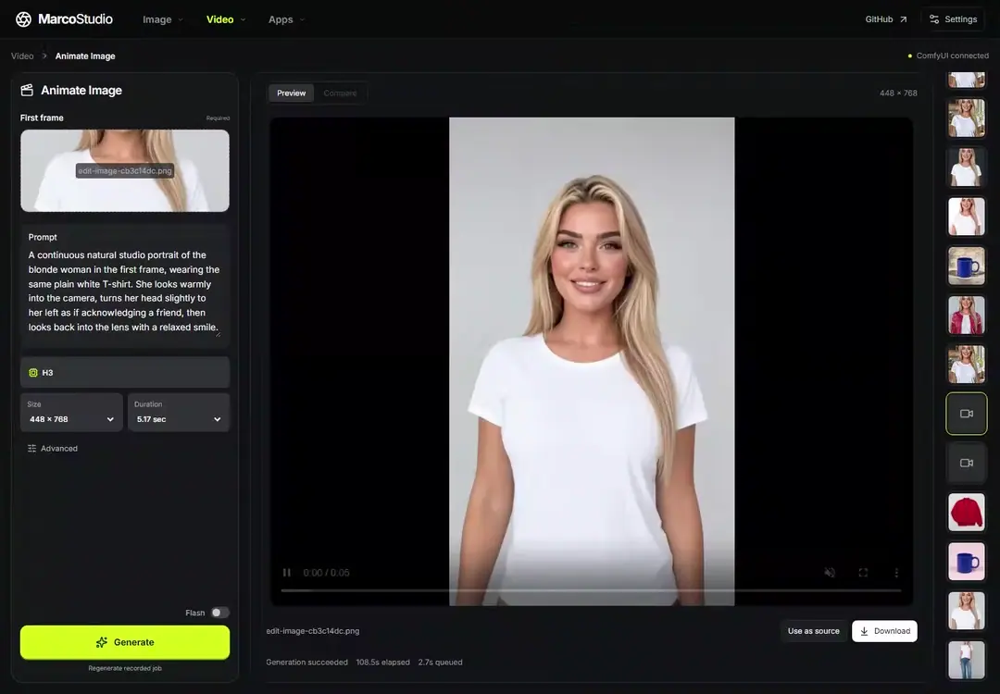
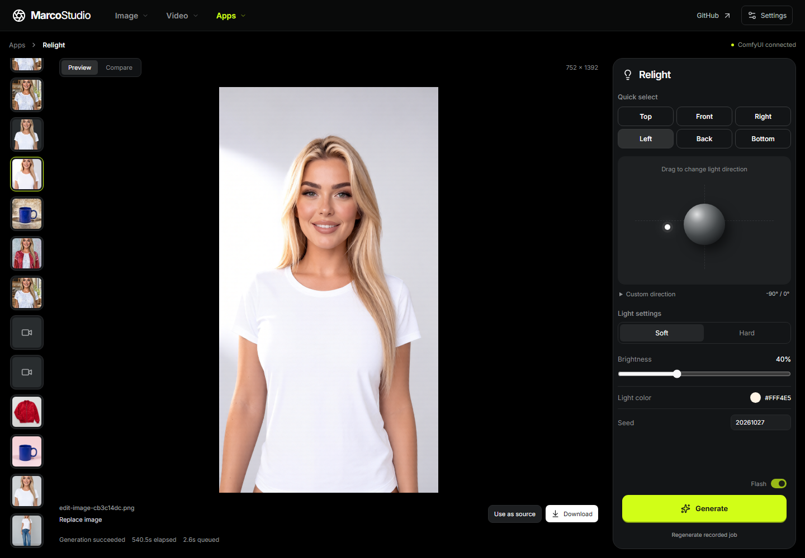
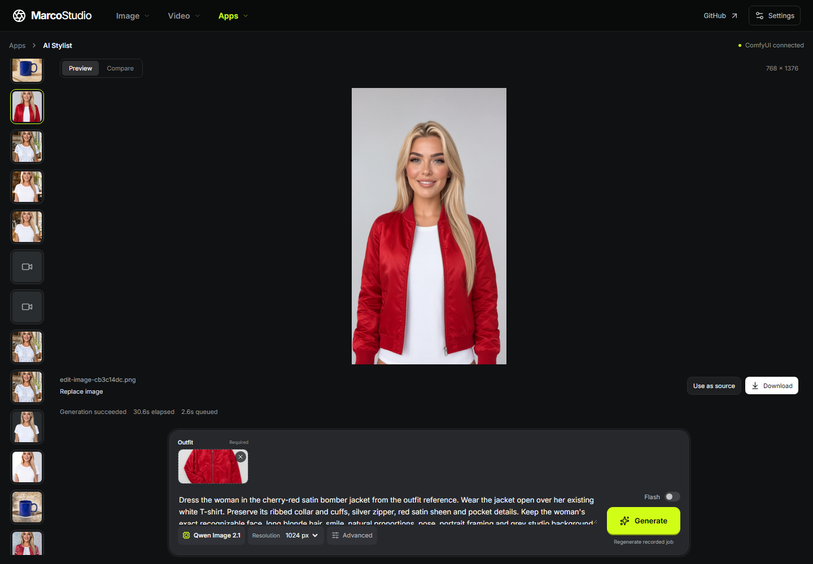
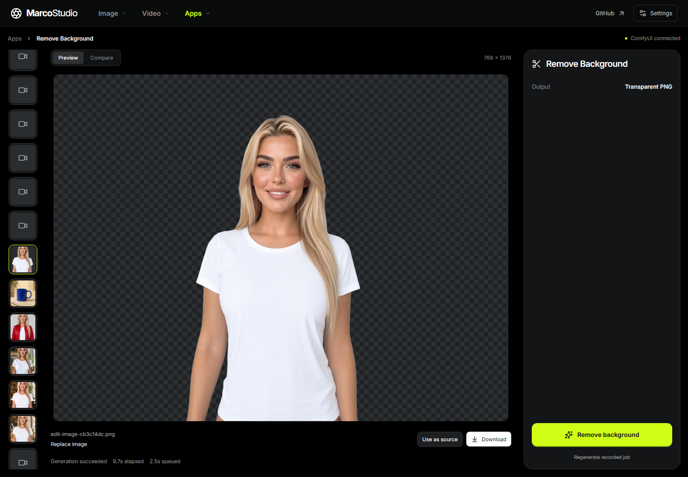
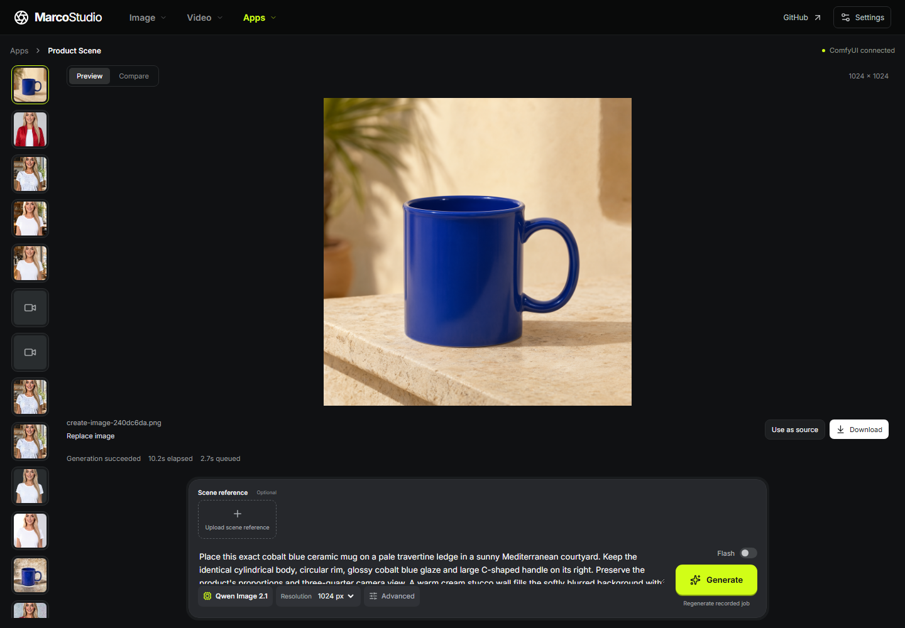

# MarcoStudio

Relight photos, change outfits, remove backgrounds, and make videos with your own ComfyUI.

**[Open MarcoStudio](https://neomarcopolo.co/marcostudio/)** · [Watch the demo](https://youtu.be/VXpRK7vRnTw) · [Tools](#tools) · [Get started](#get-started) · [Run locally](#run-locally)

The [100-second demo](https://youtu.be/VXpRK7vRnTw) ([MP4](assets/readme/demo.mp4)) shows real runs with their real generation times, and how MarcoStudio talks to your ComfyUI.

[](https://github.com/NeoMarcoPolo/marcostudio/actions/workflows/ci.yml)
[](LICENSE)



**ComfyUI must be installed and running on your computer.** MarcoStudio supplies the interface and workflows; your ComfyUI runs them. No MarcoStudio account or credits.

<table>
<tr>
<td width="50%"><br><b>Relight.</b> Set the light direction, softness, brightness and color.</td>
<td width="50%"><br><b>AI Stylist.</b> Give it a person and an outfit reference.</td>
</tr>
<tr>
<td width="50%"><br><b>Remove Background.</b> Download a transparent PNG.</td>
<td width="50%"><br><b>Product Scene.</b> Place a product in a scene described by a prompt or reference.</td>
</tr>
</table>

These are actual MarcoStudio runs.

## Tools

| Tool | Inputs | Model | Modes |
| --- | --- | --- | --- |
| Relight | Photo + light controls | Qwen Image Edit 2509 + Relight | Flash |
| Remove Background | Photo | Qwen Image 2.1 | Standard |
| Create Image | Prompt | Qwen Image 2.1 | Standard / Flash |
| Edit Image | Photo + prompt + up to three references | Qwen Image 2.1 | Standard / Flash |
| AI Stylist | Person + outfit reference | Qwen Image 2.1 | Standard / Flash |
| Product Scene | Product + scene prompt or reference | Qwen Image 2.1 | Standard / Flash |
| Create Video | Prompt | MiniMax H3 | Standard / Flash |
| Animate Image | First frame + prompt | MiniMax H3 | Standard / Flash |
| Transition | First and last frames + prompt | MiniMax H3 | Standard / Flash |
| Restyle Video | Video + prompt + optional image references | MiniMax H3 OmniRef | Standard / Flash |
| Replace Person | Video + person reference | MiniMax H3 + Character Swap V1.5 | Standard (eight steps) |
| Keyframes | First frame + one to three timed images + prompt | MiniMax H3 OmniRef | Standard |
| Motion Control | Video + prompt + optional edit mask | MiniMax H3 | Standard |

Flash uses eight-step Qwen Turbo or FastH3 checkpoints; Relight uses a four-step adapter. Download only what you use.

**Status: alpha.** The tools are experimental. GPU memory and generation time depend on the workflow and your ComfyUI setup; a minimum VRAM requirement has not been established. Model licenses are separate from the application's MIT license—see [License](#license).

## Model downloads

Total model files per tool and mode, in GB (10⁹ bytes), from the [model catalog](frontend/src/browser/catalog.json):

| Tool | Standard | Flash |
| --- | ---: | ---: |
| Relight | – | 31.2 GB |
| Remove Background | 17.3 GB | – |
| Create Image | 17.3 GB | 17.3 GB |
| Edit Image | 17.3 GB | 17.3 GB |
| AI Stylist | 17.3 GB | 17.3 GB |
| Product Scene | 17.3 GB | 17.3 GB |
| Create Video | 53.9 GB | 55.1 GB |
| Animate Image | 53.9 GB | 55.1 GB |
| Transition | 53.9 GB | 55.1 GB |
| Restyle Video | 53.9 GB | 55.2 GB |
| Replace Person | 44.6 GB | – |
| Keyframes | 53.9 GB | – |
| Motion Control | 58.5 GB | – |

Tools share files, and setup reuses files ComfyUI already has. Each file is downloaded once:

- The five Qwen Image 2.1 tools use the same Standard files: 17.3 GB for all five, 24.5 GB with Flash.
- The video tools share the H3 text encoder and VAEs: 141.6 GB for all seven in every mode.
- Relight's files are separate. All 13 tools in every mode: 197.3 GB.

## Get started

1. **Start ComfyUI.** Install [ComfyUI Desktop](https://comfy.org/download) or use an existing [portable/manual installation](https://docs.comfy.org/installation/system_requirements). Confirm its editor opens in your browser and leave it running.
2. **[Open MarcoStudio](https://neomarcopolo.co/marcostudio/) and connect.** Allow local-network access if your browser asks. Setup checks the models and nodes for your selected tool.
3. **Finish the missing requirements, then open the studio.** Select the missing models you want, review their sizes and confirm before downloading. **Models and nodes** lists other requirements. Completed steps are skipped on your next visit.

Your browser connects directly to your ComfyUI. The website needs no MarcoStudio server or proxy, and your media stays between your browser and ComfyUI.

<details>
<summary>ComfyUI is running, but the website cannot connect</summary>

Choose **It's already running** in setup, then select your launcher. It gives you this option to copy:

```text
--enable-cors-header https://neomarcopolo.co
```

Append it to your existing ComfyUI startup options:

| Launcher | Where |
| --- | --- |
| Desktop | Instance ⋮ → **Manage → Startup Args → Startup Arguments** |
| Windows portable | Your `.bat` launcher, on the line containing `ComfyUI\main.py` |
| Terminal | Your usual ComfyUI launch command |

Restart ComfyUI when its queue is idle, then return to MarcoStudio and retry. Also allow local-network access in your browser's site settings.

For a locally hosted MarcoStudio, copy the option shown by that page's setup screen—it uses that page's origin. [ComfyUI startup flags](https://docs.comfy.org/development/comfyui-server/startup-flags) · [Desktop startup arguments](https://docs.comfy.org/installation/desktop/usage/manage#startup-args-tab).

</details>

<details>
<summary>Models, custom nodes, and another ComfyUI address</summary>

- Setup checks Relight first by default; other tools are checked when selected.
- Automatic model downloads use **ComfyUI-Manager 4**. Setup shows each missing file and the selected total before confirmation, reuses matching files, and writes to ComfyUI's configured model folders. Check free space on the ComfyUI machine, including room for temporary files. Without Manager, already installed tools still work.
- Custom node installation is currently manual. Update built-in nodes through ComfyUI. Restyle Video, Motion Control and Replace Person also need MarcoStudio's video nodes: download them from **Models and nodes**. They are not yet in the Comfy registry. Restart ComfyUI when idle after installing nodes.
- FastH3 OmniRef needs [ComfyUI's PDD support](https://github.com/Comfy-Org/ComfyUI/commit/ce42de5f64ac1d421e304ab7b6c0b3d2f0dde1f6). Setup checks the running implementation.
- Connection checks local ports **8188** and **8000**. Use **Change address** for another port or machine. On a phone, use the address that opens ComfyUI from that phone.
- Readiness checks node contracts, model names, and the Manager queue when available. An active queue blocks readiness, including unrelated Manager tasks. An interrupted or corrupt file can still appear under its expected name after the queue becomes idle; the browser does not verify checksums. The Python CLI's `doctor --verify-hashes` also verifies model file checksums. Manager's queue check is not atomic across separate browser profiles, so simultaneous download requests can still race.

For an optional basic check, **Try a sample** offers an image and a small ComfyUI workflow. The workflow loads and saves the image; it tests image input and output, not model inference, and runs only when you choose to run it in ComfyUI. The sample image is attributed to Get Craver.

Setup never restarts ComfyUI or submits a generation.

</details>

## Run locally

Start ComfyUI first. To run the frontend on your computer, you need Git and Node 22.12+:

```sh
git clone https://github.com/NeoMarcoPolo/marcostudio.git
cd marcostudio/frontend
npm ci
npm run dev
```

Open the printed address with `?runtime=browser` appended, then connect to ComfyUI. The same setup flow handles the connection and missing requirements.

<details>
<summary>Optional Python application and CLI (Windows)</summary>

This version includes the interface, a local API, file storage and job history. Node is not required. You need Python 3.12+, a running ComfyUI, and FFmpeg/FFprobe on `PATH` for video tools.

Install the [v0.2.0 release](https://github.com/NeoMarcoPolo/marcostudio/releases/tag/v0.2.0) wheel in a new virtual environment:

```powershell
py -3.12 -m venv .venv
.\.venv\Scripts\python.exe -m pip install https://github.com/NeoMarcoPolo/marcostudio/releases/download/v0.2.0/marcostudio-0.2.0-py3-none-any.whl
```

Or, from a checkout of this repository, run `py -3.12 -m venv .venv` and `.\.venv\Scripts\python.exe -m pip install .` at its root.

Then configure it. Replace `C:\AI\ComfyUI` with the folder containing ComfyUI's `main.py`, and use your running ComfyUI's address:

```powershell
.\.venv\Scripts\marcostudio.exe configure --comfy-dir "C:\AI\ComfyUI" --comfy-url "http://127.0.0.1:8188"
.\.venv\Scripts\marcostudio.exe install-nodes
.\.venv\Scripts\marcostudio.exe models
```

`models` lists Relight's download URLs and destination folders. Select another tool with `models --feature <tool-id>` and add `--mode flash` for its Flash models. Download the listed files. Restart ComfyUI when idle after `install-nodes` to load the MarcoStudio nodes.

Start the proxy and leave it running:

```powershell
.\.venv\Scripts\marcostudio.exe proxy
```

In a second PowerShell terminal in the same folder:

```powershell
.\.venv\Scripts\marcostudio.exe doctor --feature relight --verify-hashes
.\.venv\Scripts\marcostudio.exe serve
```

Open [http://127.0.0.1:7870](http://127.0.0.1:7870). Once dependencies and models are installed, the Python application works offline. Its server accepts local connections only.

</details>

<details>
<summary>Python configuration and CLI examples</summary>

Configuration, media and history live in your OS's MarcoStudio application-data directory, outside the checkout. Use `configure --data-dir ...` to change it for the next server start. Close the server before backing up that directory.

The Python application defaults to ComfyUI at `http://127.0.0.1:8188` and its proxy at `http://127.0.0.1:8189`. Change them in Settings or with `configure --comfy-url ... --proxy-url ...`; restart the proxy after changing its configuration.

ComfyUI's `extra_model_paths.yaml` is discovered automatically. Add other files with `configure --extra-model-path "C:\AI\extra_model_paths.yaml"` (repeatable). To select a configuration file, put `--config <file>` before the command or set `MARCOSTUDIO_CONFIG`.

These commands assume the virtual environment is activated:

```powershell
marcostudio doctor --feature relight --verify-hashes
marcostudio models --feature create-image --mode flash --json
marcostudio run relight --input photo.png --direction front --mode flash --seed 42 --wait 600
marcostudio run ai-stylist --input person.png --asset reference_1=outfit.png
marcostudio run animate-image --input photo.png --prompt "Slow camera push forward"
marcostudio jobs list
marcostudio jobs show <job-id>
```

`doctor` checks setup without downloading or generating; `--all` checks every tool's default mode. `run` and `jobs` need the studio server. A `--wait` timeout leaves the job running. Use `marcostudio <command> --help` for all options.

</details>

## How it works

```text
MarcoStudio in your browser → your ComfyUI → your GPU
```

The [feature registry](src/marcostudio/features) defines each tool's settings, model requirements and workflow. The frontend uses an [exported catalog](frontend/src/browser/catalog.json) to build and submit those workflows directly to ComfyUI. [Video adapters](src/marcostudio/comfy_nodes) are included in the repo.

Image results support comparison, download and reuse as the next input. Videos play in the studio. Job history restores the tool, prompt, settings and references, and continues tracking after a page refresh.

<details>
<summary>Input limits and current behavior</summary>

- Images: PNG/JPEG up to **32 MiB** and **32 megapixels**.
- Video inputs: MP4 up to **15 seconds** and **96 MiB**, normalized to 24 fps. Generated durations follow H3's frame grid.
- Remove Background uses a generative workflow at about a 1024 × 1024 pixel budget. It preserves transparency, but can change foreground details and output dimensions.
- Outfit and product references guide generation; they do not guarantee an exact texture transfer.
- Replace Person processes up to **five seconds**, uses a full-body person reference, and keeps source audio.
- Keyframe timestamps must increase and stay within the output duration.
- Motion Control accepts source edges or a prepared control video. With an edit mask, white replaces and black preserves; source pixels outside the mask are composited back.
- Browser history is stored locally. Clearing browser data removes its records, so download results you want to keep.
- Uncertain submissions are checked against ComfyUI's queue/history without resubmitting. Check ComfyUI before trying again; **Resolve uncertain job** ends tracking only after you confirm it is no longer running.
- Queued jobs can be removed by ID. Cancel running jobs in ComfyUI; MarcoStudio does not send a global interrupt.

</details>

## Contributing

[Report a bug](https://github.com/NeoMarcoPolo/marcostudio/issues) with your OS, ComfyUI version and steps to reproduce it. For the Python application, include its Python version too. Remove personal paths and image data from diagnostics before sharing. Pull requests are welcome.

For a new tool, start with the [feature registry](src/marcostudio/features), define its models and workflow, and add its controls in [the frontend](frontend/src). The browser catalog is generated from the Python workflows so both runtimes share the same definitions.

<details>
<summary>Development commands</summary>

Use Python 3.12 and Node 22.12+. Dependencies are pinned in `uv.lock` and `frontend/package-lock.json`.

```powershell
uv sync --locked --extra dev
cd frontend
npm ci
npm run test -- --run
npm run build
cd ..
.\.venv\Scripts\python.exe -m pytest
.\.venv\Scripts\python.exe -m ruff check src tests
.\.venv\Scripts\python.exe -m build
```

Tests require no GPU. CI checks the frontend and installs the Python package on Windows, Linux and macOS.

After changing workflows or video nodes, run `.\.venv\Scripts\python.exe -m marcostudio.browser_export` at the repo root, then rebuild the frontend. `npm run build` includes type checking and writes the static site to `src/marcostudio/web`. Rebuild it before publishing interface changes.

Without `?runtime=browser`, the frontend uses a local MarcoStudio server if its settings API responds, otherwise it uses the browser connection. The Vite proxy targets port 7870 for the Python application.

</details>

## License

Application code is [MIT licensed](LICENSE). Model weights are downloaded separately and have their own terms:

- **Qwen Image 2.1:** the [Qwen Research License](https://huggingface.co/Qwen/Qwen-Image-2.1/blob/main/LICENSE) permits research and evaluation; commercial use requires a separate license.
- **MiniMax H3:** video tools are Powered by MiniMax H3. See the [H3 and Character Swap license](https://huggingface.co/akatz-ai/MiniMax-H3-Character-Swap-LoRA/blob/96ea3407b230b6f7df71c58c70e31df96bd7e533/LICENSE).

[THIRD_PARTY_NOTICES](THIRD_PARTY_NOTICES) lists workflow sources, bundled libraries, adapters and model licenses.
